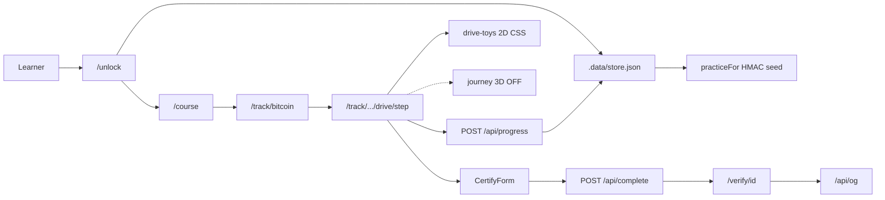

# Crypto Drive — External auditor handoff dossier

**Prepared for:** Bitcoin curriculum architect, instructional designer, UX auditor  
**Repo inspected:** `crypto-drive` (local workspace)  
**Remote:** `origin.cursor.com/f-a/genesis.git` (Origin host)  
**Date of inspection:** 2026-10-15  
**Secrets policy:** No API keys, `.env` values, private keys, seed phrases, customer PII, or production credentials included. Unknowns marked **TODO**.

---

## 1. Product summary

| Field | Finding |
| --- | --- |
| **What it is** | **Crypto Drive** — a “learn to drive” style wallet-coaching course: short coach cues, sequential practice screens, optional attestation certificate. |
| **Purpose** | Teach non-technical professionals how to *use* Bitcoin (receive, verify, send, guard keys) with play-money drills, then expand to ETH / USDT / Tron / Solana. Drive Gumroad sales via shareable verify links. |
| **Stage** | **MVP / pre-charge prototype.** Bitcoin first drive is “ready” in content status; ETH/USDT/Tron/Solana are scaffolds. Docs explicitly say do not charge yet. File-backed demo store; Gumroad CTA is a placeholder; no live license webhooks. |
| **Public / staging URL** | Local default: `http://127.0.0.1:43127`. Production public URL: **TODO** (env `NEXT_PUBLIC_APP_URL`; Vercel implied in architecture docs, not verified as live). |
| **Who uses it** | Learners unlock with a license key; tiers Starter / Certified / VIP. No separate admin or instructor console in-app today. |

---

## 2. Audience and goals

### Primary learners

- Non-tech **professionals** (positioned for regulated industries / “waiting is the risk”).
- Absolute beginners needing mental models without jargon.
- Serious learners who want proof of completion (Certified).
- High-touch / VIP: call + Q&A CTAs (fulfillment tooling incomplete).

Bankers / compliance / executives are the **marketing positioning**, not separate in-product personas yet.

### Secondary users

| Role | Status |
| --- | --- |
| Admins | **TODO** — no admin UI |
| Instructors / coaches | **TODO** — no instructor dashboard; VIP call URL is env placeholder |
| Content authors | Edit JSON under `content/` + docs under `docs/` |

### Business / learning goals

- Gumroad tier purchase → unlock → finish Bitcoin road → (Certified+) one cert + `/verify/[id]` share loop.
- Learning outcome (Bitcoin): explain scarcity/blocks/sats; receive; prove landing; send small amount; never share seed; catch swap/wrong-network/support scams.

### Success metrics

Documented qualitative bar (`docs/course-agenda.md`): a non-tech friend finishes Certified and can describe address, explorer/tx, receive/send, seed hygiene, wrong-network risk.  
Instrumented product metrics (completion rate, time-on-task, cert shares): **TODO**.

---

## 3. Tech stack and architecture

| Layer | Choice |
| --- | --- |
| Frontend | Next.js **16.4** App Router, React **19**, TypeScript, Tailwind CSS **4** |
| Backend | Next.js Route Handlers under `src/app/api/*` (same app) |
| Database | **None.** File store `.data/store.json` via `src/lib/store.ts` |
| Hosting | Intended: **Vercel** (docs). Current verified runtime: local port **43127**. Public deploy: **TODO** |
| Auth | Cookie session `cd_session` (`src/lib/session.ts`); unlock maps license → tier; no magic-link / OAuth / Supabase yet |
| Cert images | `@vercel/og` (`src/app/api/og/route.tsx`) |
| 3D (optional) | `three` + `@react-three/fiber` + `@react-three/drei` under `src/components/journey/` — **disabled** by `JOURNEY_3D_ENABLED = false` |
| Build | `next` / Turbopack in dev; ESLint |

### High-level architecture



### Data flow

| Concern | Flow |
| --- | --- |
| **Course content** | Static JSON in `content/tracks/*.json` + `content/tiers/*.json` → loaded by `src/lib/content.ts` |
| **Quizzes / drills** | Step `action` types in JSON; UI in `DriveStep`; answers graded in `gradeStepAnswer` (`practice-samples.ts`) on `POST /api/progress` |
| **Progress** | `student.modulesPassed[stepId] = ISO timestamp` in file store; gating via `stepBlockedReason` / `driveUnlocked` (`src/lib/drive.ts`) |
| **Bitcoin data** | **Simulated only.** Addresses / txids / fees / cheques / BIP39 words derived from `derivePracticeSeed(email, license)` → `practiceFor(seed)`. No live chain APIs. |

---

## 4. Routes, pages, and screens

| Route/path | Page/screen name | Purpose | Key components | Current copy/title/hint | Known issues | Screenshot / Figma |
| --- | --- | --- | --- | --- | --- | --- |
| `/` | Landing | Brand + CTA into unlock / Gumroad; chain tiles | `page.tsx`, `ChainTiles`, `SiteHeader` | “Learn to use… the way you’d learn to drive” | Gumroad URL may be placeholder | **TODO** |
| `/unlock` | License unlock | Email + license → session | `UnlockForm` | “Enter your key. Get behind the wheel.” | Demo keys hardcoded in docs/README | **TODO** |
| `/course` | Course map | Tier path; open Bitcoin | `course/page.tsx` | Tier name + track list | Scaffold tracks show “coming next” | **TODO** |
| `/track/[slug]` | Track hub | Drive list + lock state | `track/[slug]/page.tsx` | Bitcoin: “Meet Bitcoin. Then drive it.” | — | **TODO** |
| `/track/[slug]/[drive]` | Drive entry | Redirect into first unfinished step | `drive/page.tsx` | n/a (redirect) | — | — |
| `/track/[slug]/[drive]/[step]` | Drive step | Split: left toy / right coach+drill; Back/Continue | `DriveStep`, `drive-toys`, optional `JourneyStageLazy` | Job + `coachLine` + per-step `idea*` JSON; explorer-read graded checks | 3D off (`JOURNEY_3D_ENABLED=false`) | **TODO** |
| `/cert/[id]` | Certificate view | Graduate cert UI | `cert/[id]/page.tsx`, share | Cert labels from step `cert` | Starter upgrade path | **TODO** |
| `/verify/[id]` | Public verify | Attestation check | `verify/[id]/page.tsx` | Public proof page | — | **TODO** |
| `/module/[slug]`, `/module/1` | Legacy redirects | Old Slice 1 URLs | `resumeHref` or `/track/bitcoin/what-is/satoshi` | — | Fixed; regression in `tests/module-redirects.test.mjs` | — |
| `/api/unlock` | Unlock API | License intake | route | — | — | — |
| `/api/progress` | Progress API | Grade + pass step | route | — | — | — |
| `/api/complete` | Cert issue | Issue / reuse cert | route | — | One cert per track | — |
| `/api/og` | OG image | Cert PNG | route | — | — | — |

---

## 5. Course content model

### Structure (Bitcoin)

Not classic “modules / chapters / lessons / quizzes.” Shipping model:

| Concept | Implementation |
| --- | --- |
| Track | `content/tracks/bitcoin.json` (`status: "ready"`) |
| Drive (“stop”) | 5 drives: What Bitcoin is · Get paid · Send a little · Guard the car · Road test |
| Step (“screen”) | 18 steps with `job`, `coachLine`, `button`, `action`, optional `idea*` / `pocketCard` / `cert` |
| Quizzes | Interactive `action` types (not MCQ banks): `intro`, `address-check`, `receipt`, `explorer-read`, `clipboard-mismatch`, `fee-room`, `send-confirm`, `key-contrast`, `seed-card`, `scene` |
| Progress | Per-step pass in store; sequential unlock |

Other tracks (`ethereum`, `usdt-networks`, `tron`, `solana`): scaffolds in `content/tracks/` + `index.json` order.

### Content storage

- **Format:** JSON files (not MDX/CMS/DB).
- Titles / subtitles / coach lines / buttons / pocket cards: fields on each step in `bitcoin.json`.
- Learning objectives: drive-level `outcome` + step `job`.
- Tier packaging: `content/tiers/{starter,certified,vip}.json` + `content/tiers/index.json` demo license map.

### Per-step idea panels (shipped)

What-is steps and the explorer lesson load `ideaTitle`, `ideaBody`, `objective`, `whyItMatters`, `keyTerms`, and `misconception` from JSON into `IdeaPanel` in [`src/components/drive-step.tsx`](src/components/drive-step.tsx). `PictureIntro` placeholder removed. Unique-`ideaBody` guarded by `tests/practice-samples.test.mjs`.

---

## 6. UI component inventory

| Area | Components / notes |
| --- | --- |
| Cards / frames | Local `Frame` in `drive-step.tsx`; cabin panels via CSS vars |
| Modals | No dedicated modal system; full pages + inline frames |
| Transaction / receipt flow | `ReceiptScene`, confirm counter 0→1→3 (`useConfirmations`) |
| Sign and send | Change intro “Sign and send”; send-confirm “Send the test anyway” |
| Address validation / mismatch | `AddressScene` (first/last 4); `SwapScene` / road-test `mismatch` |
| UTXO / unspent cheques | `ChequesIntro` + `ChequesToy` stack animation |
| Animations | CSS toys in `drive-toys.tsx` + `globals.css` (hit/miss/win); route stage ambient motion; optional R3F journey (**off**) |
| Responsive | Drive split stacks ~900px (`drive-split`); foot sticky Back / primary |
| Accessibility | Some `role="alert"`; `prefers-reduced-motion` CSS; theme `aria` via toggle. Full a11y audit: **TODO** |
| Empty / loading / error / success | Busy flags; localError strings; pocket card `success-burst`; cert / upgrade panels |
| Design tokens | Syne + Figtree; CSS vars `--amber`, `--btc`, `--on-btc` (white on orange), light/dark |

---

## 7. Bitcoin data and integrations

| Question | Finding |
| --- | --- |
| Source of txids, addresses, fees, confirms, blocks | **Generated** in `src/lib/practice-samples.ts` from learner practice seed. Confirmations are a **client timer**, not chain data. |
| mempool.space used? | **Deep-link only (Model A).** No runtime API. Explorer step opens a verified mainnet tx in a new tab. |
| Real / fake / truncated / generated? | Practice drills: **generated** `bc1q…` / txids / BIP39 from seed. Explorer lesson: **verified** pizza tx `a1075db55d416d3ca199f55b6084e2115b9345e16c5cf302fc80e9d5fbf5d48d` (~4191 sat/vB; see `src/lib/explorer-lesson.ts`). |
| Candidate txid `fe73e7af…7116` | Queried 2026-10-15 → **404**. **Not used.** |
| Teaching explorers | Simulated receipt step + graded `explorer-read` (confirmed / confirmations floor / fee rate range). Privacy warning on looking up own addresses. |
| testnet / signet / mainnet | **None.** No network RPCs. Addresses use HRP `bc` (mainnet *format*) but are not claimed as funded mainnet wallets. |

---

## 8. Known bugs and UX issues

| Severity | Page/component | Description | Reproduction | Screenshot | Impact on professional learners |
| --- | --- | --- | --- | --- | --- |
| **Fixed** | `/module/*` | Redirects via `resumeHref` or `/track/bitcoin/what-is/satoshi` | `tests/module-redirects.test.mjs` | — | — |
| **Fixed** | What-is idea panels | Per-step JSON + `IdeaPanel`; no `PictureIntro` | Open any what-is step | — | — |
| **Fixed** | Tier flags | `fullPractice` / `certificate` / `verifyLink` / `liveCall` | `tests/tier-features.test.mjs` | — | Starter practices all; cert is Certified upsell |
| **Fixed** | Explorer pedagogy | Model A pizza tx + three graded checks | Get paid → explorer | — | — |
| **P2** | Journey 3D | Full R3F stack in repo but `JOURNEY_3D_ENABLED = false`; dual animation systems (CSS toys vs 3D worlds) | Code review `enabled.ts` | — | Risk of design drift; auditors may audit unused 3D |
| **P2** | Persistence | File store only; not multi-instance / durable for production | Deploy two instances | — | Progress/certs not production-safe |
| **P2** | Gumroad / VIP | CTA + Calendly env placeholders; no webhook fulfillment | Unlock marketing path | — | Purchase loop incomplete |
| **P0** | Charge readiness | Docs: do not take payment until curriculum is real in-app | Product policy | — | Blocking go-to-charge |

No automated E2E suite beyond `tests/practice-samples.test.mjs` (practice uniqueness/grading). Broader bug list: **TODO** (manual QA pass recommended).

---

## 9. Constraints

| Constraint | Detail |
| --- | --- |
| Brand / design | “Learn to drive” coach tone; Syne/Figtree; amber/BTC orange; white on orange (`--on-btc`); avoid academic Moodle look (`docs/course-agenda.md`, frontend design rules) |
| Accessibility | Reduced-motion support for toys/stage; full WCAG target: **TODO** |
| Compliance / legal | Play money only; no asking for real funds; seed drills use generated words (still treat as sensitive). Real-mainnet challenges deferred. |
| Timeline | **TODO** |
| Team size / roles | **TODO** |
| Must not change (locked in docs) | Gumroad-only payments (no Stripe); tier names; curriculum spine BTC→ETH→USDT/Tron→Solana; coach tone; one cert per Bitcoin course for Certified+ |

---

## 10. Assets

| Asset | Location / status |
| --- | --- |
| Figma | **TODO** — none in repo |
| Screenshots | **TODO** — not checked into `docs/` |
| Videos | Ad video planned later (`project-context.md`); not in repo |
| Logos | Text brand + `crypto-marks.tsx` SVG marks; `public/*.svg` are Next defaults |
| Diagrams | Mermaid-capable docs; journey storyboards in `docs/journey-storyboards.md` |
| Animation assets | CSS in `globals.css`; 2D toys `drive-toys.tsx`; optional 3D `src/components/journey/**` |

---

## 11. How to run and test

### Commands

```bash
npm install
cp .env.example .env.local   # optional
npm run dev                  # http://127.0.0.1:43127
npm run build
npm start
npm run lint
node --test tests/practice-samples.test.mjs   # practice grading tests (if run that way in CI — verify locally)
```

### Environment variables (names only; values redacted)

| Variable | Purpose |
| --- | --- |
| `DEMO_LICENSE_KEY` | Default demo license fallback |
| `NEXT_PUBLIC_GUMROAD_URL` | Purchase CTA |
| `NEXT_PUBLIC_APP_URL` | Canonical app URL for shares |
| `NEXT_PUBLIC_VIP_CALL_URL` | VIP scheduling CTA |
| `NEXT_PUBLIC_VIP_QA_URL` | VIP Q&A CTA |
| `CERT_HASH_SECRET` | Used for practice seed HMAC + cert hashing (dev default exists in code if unset — **rotate before production**) |

### Test accounts / licenses (demo; not production secrets)

| License key | Tier |
| --- | --- |
| `CD-DRIVE-STARTER` | Starter |
| `CD-DRIVE-2026` | Certified (common demo) |
| `CD-DRIVE-CERTIFIED` | Certified |
| `CD-DRIVE-VIP` | VIP |

Use any email + a key above on `/unlock`. Practice address/words change with email+license pair.

### Testnet / signet

Not applicable — no on-chain practice network.

---

## 12. Repo map

### Key directories

| Path | Role |
| --- | --- |
| `content/tracks/` | Curriculum JSON |
| `content/tiers/` | Packaging + demo license map |
| `docs/` | Product / curriculum / architecture briefs |
| `src/app/` | Routes + API |
| `src/components/` | UI, drive step, toys, journey |
| `src/lib/` | Content load, drive nav, store, practice |
| `tests/` | BIP39 wordlist + practice sample tests |
| `.data/` | Local runtime store (gitignored pattern — treat as sensitive) |

### Course content

- `content/tracks/bitcoin.json`
- `content/tracks/index.json`
- `docs/course-guides/bitcoin.md`
- `docs/course-agenda.md`

### UI

- `src/components/drive-step.tsx`
- `src/components/drive-toys.tsx`
- `src/components/chain-tiles.tsx`
- `src/components/unlock-form.tsx`
- `src/components/certify-form.tsx`
- `src/components/ui/*`

### Bitcoin / practice data

- `src/lib/practice-samples.ts`
- `src/lib/practice-types.ts`
- `tests/bip39-english.txt`
- `tests/practice-samples.test.mjs`

### Animations

- `src/app/globals.css` (toys, stage, dopamine classes)
- `src/components/drive-toys.tsx`
- `src/components/journey/**` (3D, disabled)
- `src/components/route-stage.tsx`

---

## 13. Open questions for the auditor

1. Confirm go-to-market URL and whether Origin/Vercel staging is the review environment.
2. Target WCAG level and any corporate brand kit / Figma source of truth?
3. Keep CSS 2D toys as the learner path, or re-enable Journey 3D (`JOURNEY_3D_ENABLED`)?
4. Liability stance on displaying BIP39-looking words (even if generated) in screenshots / screen-share contexts.
5. Timeline and definition of “charge-ready” for Gumroad launch.

*(Resolved in-repo: per-step idea JSON; Model A pizza explorer with graded checks; tier flags `fullPractice` / `certificate` / `verifyLink` / `liveCall`; `/module/*` resume redirects; play-money tag on practice drives.)*

---

## 14. Suggested next-step plan

### First (P0 / charge blockers)

1. Decide charge-ready criteria against `docs/course-agenda.md` bar.
2. Manual UX pass on explorer three-checks + CopyChip affordance.

### Second (learning integrity)

1. Candidate `fe73e7…7116` remains **not found** — do not use.
2. UX pass on dopamine toys for cognitive alignment (left ↔ right) on change/address/receipt/road-test.

### Third (platform)

1. Replace file store with durable DB (Supabase planned in docs).
2. Live Gumroad license webhooks.
3. VIP scheduling fulfillment.
4. Production `CERT_HASH_SECRET` + session hardening.
5. Either ship or delete/archive unused 3D journey to reduce audit surface.
6. Add screenshot pack + Figma for external auditors.

### Verified Bitcoin data (explorer lesson)

| Item | Status |
| --- | --- |
| Pizza txid `a1075db55d416d3ca199f55b6084e2115b9345e16c5cf302fc80e9d5fbf5d48d` | Confirmed mainnet; block 57043; fee rate ~4191 sat/vB (`src/lib/explorer-lesson.ts`) |
| Practice addresses / txids | Generated play money only |
| White paper / bitcoin.org links | Present on Satoshi step |

---

*End of dossier. No secrets included. Marked TODOs require product owner or staging access.*
