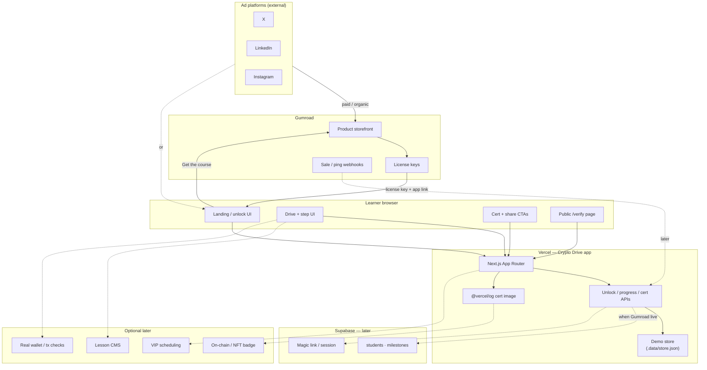

# Crypto Drive — Solution Architecture

> **Status note (Oct 2026):** §§1–7 describe the slice-1 baseline
> (file store, mock commerce) and predate the shipped Supabase, Gumroad,
> revocation, hashing, rate-limit, and Bitcoin-provider work. They are kept
> as design history. For the system as it runs today, read §§8–10 plus
> `docs/deployment-modes.md`, `docs/infra-contract.md`,
> `docs/deploy-vercel.md`, and `docs/charge-ready-checklist.md`.

Whole-system map for the licensed learner loop: ads → Gumroad → unlock → six drives → capstone cert → verify → share. Aligned with locked brand, Gumroad-only commerce, pro “learn to drive” positioning, **simulated milestones**, and **off-chain certs**.

---

## 1. System component diagram

Where each major piece lives.

---

## 2. Component inventory

| Component | Responsibility | Hosted / found where | Now (slice 1) vs Later |
| --- | --- | --- | --- |
| Ad creatives (X / LinkedIn / Instagram) | Drive traffic to Gumroad (or landing) | Ad platforms | **Later** — slogan + video deferred |
| Gumroad storefront | Checkout, product page, license issue | Gumroad | **Later** — placeholder URL in slice |
| Gumroad license keys | Unique buyer access credential | Gumroad | **Mock** now; live keys later |
| Gumroad webhooks / License API | Sync sale → student record; verify key | Gumroad → app | **Later** |
| Landing page | Pitch + “Get course” + “I have a license” | Vercel (Next.js) | **Now** |
| Unlock / access gate | Accept email + license; grant tier path | Vercel app | **Now** (demo keys; Gumroad verify later) |
| Drive + step UI (Bitcoin: 6 drives, 26 steps) | Coach cues + graded drills + capstone | Vercel app (in-app content) | **Now** |
| Track C (USDT: 3 drives, 10 steps) | Network-picker drills + capstone cert | Vercel app (in-app content) | **Now** |
| Tracks ETH / Tron / Solana | Later tracks | Vercel app | **Scaffold** (`status: "coming"`) |
| Cert generator | Name, date, unique id/hash → PNG | Vercel (`@vercel/og` / satori) | **Now** |
| `/verify/[certId]` | Public attestation page | Vercel (public route) | **Now** |
| Share CTAs | Intent / copy links to X, LinkedIn, Instagram | Learner browser → social apps | **Now** |
| Demo persistence | Students, milestone pass, cert id | In-app memory / JSON | **Now**; Supabase later |
| Supabase DB + auth | Persist students/milestones; sessions | Supabase | **Later** (with live Gumroad) |
| Tier packaging (Starter / Certified / VIP) | SKU → access level | App (`content/tiers/`) + Gumroad later | **Now** (cert gated by `certificate` + `verifyLink`) |
| VIP fulfillment | Scheduling / private channel | TBD tooling | **Later** |
| On-chain NFT / real tx milestones | Harder attestation / real funds practice | Chain / wallets | **Out of default**; optional later |

---

## 3. End-to-end request / data flow

Target path (live commerce). Slice 1 short-circuits steps 1–3 with a **mock license**.

**Current shortcut:** demo key (`CD-DRIVE-*`) → unlock → 26 steps → capstone cert → verify → share. No live Gumroad or Supabase.

---

## 4. Boundaries

### Not on Gumroad
- Interactive course, milestones, cert generation, verify pages  
- Student progress / attestation state  
- Full lesson body (Gumroad may host a thin welcome PDF only)

### Stays in-app (Vercel)
- Landing, unlock UI, drive/step player (6 drives, 26 steps), graded drills  
- Cert OG image + `/verify/[id]`  
- Share CTAs and coach-toned copy  

### Gumroad owns
- Product listing, payment, license key issuance  
- (Later) sale webhooks feeding the app  

### Mock / local now
- License unlock (demo keys, no webhook / License API)  
- Persistence (`.data/store.json`, not Supabase)  
- Gumroad CTA URL (placeholder)  
- Tier content ships in-app; Gumroad products mirror it later  

### Explicitly deferred / out of default
- Live ads, slogan, ad video  
- Real on-chain txs and NFT badges  
- Tracks ETH / USDT / Tron / Solana, VIP scheduling  
- Banking keynote as product scope  

---

## 5. Locked defaults (architecture constraints)

| Decision | Implication |
| --- | --- |
| Brand: **Crypto Drive** | All surfaces use this name; drive/wallet coaching metaphor |
| **Gumroad only** | No Stripe storefront; commerce boundary = Gumroad |
| Pros + “learn to drive” | Copy/UI = coach, not classroom |
| Ads → Gumroad | Acquisition lands on Gumroad; app is post-purchase |
| **Simulated** milestones | No real funds / wallet-sign liability in v1 |
| Capstone proves ops skill | Cert issues at `prove-it/explain`, not at the scam drills |
| **Off-chain** cert | Hash + public verify page; no NFT required |
| Content **in-app** | Gumroad = buy + license; course lives on Vercel |

---

## 6. Stack snapshot

| Layer | Choice |
| --- | --- |
| App | Next.js (App Router) + TypeScript + Tailwind |
| Host | Vercel |
| Commerce | Gumroad (license keys; webhooks later) |
| Data | Demo store now → Supabase later |
| Certs | `@vercel/og` / satori PNG + `/verify/[id]` |
| 3D journeys | Three.js via `@react-three/fiber` (v9, React 19 line) + `@react-three/drei` helpers, per-drive lazy chunks |

---

## 7. Immersive journey layer (2D-first; 3D parked)

**Status: the 2D illustration path is the production default.** The Glass
Observatory 3D stack below stays in-tree but unmounted and unfetched behind
the master switch `JOURNEY_3D_ENABLED=false`
(`src/components/journey/enabled.ts`; gated in `drive-step.tsx` and the drive
`layout.tsx`). Procedural low-poly 3D could not reach the senior,
realistic bar, so the CSS toy scenes in `src/components/drive-toys.tsx` are
the current experience — not the fallback.

**2D layout contract (enforced by `tests/e2e/layout.spec.ts` plus walk assertions, via `npx playwright test`):**
the left illustration card never exceeds the drive-head width
(`leftCard.right ≤ head.right`) at 1440×900 and 390×844, in both themes.
The `.drive-split` grid is symmetric at ≥900px (equal 1fr/1fr stretch columns;
the illustration card fills the row height) and stacks below that.
Each step head shows its drive's `outcome` line; Back/Continue are floating
pills with no container chrome.

**Keyboard drive:** ArrowLeft clicks Back, ArrowRight clicks the footer primary,
ArrowUp/Down rove focus through `main` — all skipped while typing in a field
(`drive-step.tsx` keydown effect; clicks live DOM so rapid presses never hit a
stale closure).

**CSS pitfall (learned the hard way):** `%` inside `calc()` is a percentage,
never a modulo operator — `calc(var(--i) % 3)` is invalid CSS and the whole
declaration is dropped (all 9 satoshi nodes and all 18 barrel coins silently
stacked at one point). Precompute grid coordinates in TSX (`--col`/`--row`)
and keep `calc()` to plain multiply/add.

Each drive was designed as one continuous 3D world with steps as camera stops
along a road. Storyboards and art direction: `docs/journey-storyboards.md`.

| Piece | File(s) | Notes |
| --- | --- | --- |
| Persistent stage | `src/app/track/[slug]/[drive]/layout.tsx` + `src/components/journey/JourneyStageLazy.tsx` + `JourneyStage.tsx` | Layout-level Canvas survives step navigation, so the camera flies instead of flashing. The whole 3D stack loads via `next/dynamic` `ssr: false` after first paint — content and HUD never wait for it. |
| Camera + lights + labels | `src/components/journey/rig.tsx` (three/fiber only), `rig-drei.tsx` (drei: labels, sparkles, valley shell) | Split keeps drei out of the route chunk. No shadow maps (blob shadows), DPR capped at 1.75, instancing for repeated geometry. FOV 38; wide-screen look-shift +1.4 X in `CameraDirector`. |
| Glass kit | `src/components/journey/rig-glass.tsx` | `VitrineShell` (active stop only), `DriveArch`, `GlassPlinth`. Fixed roof cap — win is an amber glow + dissolving front glass, never moving geometry (moving lids intrude into frame). |
| Theme | `src/components/journey/palette.ts` + `use-theme-mode.ts` | Static light/dark palettes; the 3D layer subscribes to the page theme live via `MutationObserver` on `<html class>`. Worlds re-render instantly on toggle. |
| Registry | `src/components/journey/registry.ts` | Three-free: journey-enabled drives + camera anchors per step. Safe to import from 2D UI. |
| Signal bus | `src/components/journey/journey-bus.ts` | Tiny `useSyncExternalStore` bus. 2D scenes publish progress (`cheques-progress`, `fee-pace`, …); worlds subscribe. Reset on every step change. |
| Worlds | `src/components/journey/worlds/bitcoin-*.tsx` (+ `what-is/*.tsx` vignettes) | One module per drive, dynamically imported. Vignettes read `step:win` + signals for payoffs. |
| HUD mode | `src/components/drive-step.tsx` (`BareContext` + `drive-immersive` grid) | On WebGL-capable drives the step renders as HUD panels over the world; otherwise the legacy Split + CSS toy layout renders unchanged. |

**Fallback contract (locked):**

- No WebGL (`useWebGLAvailable`) or 3D runtime error (`StageBoundary`) → legacy Split + CSS toys in `src/components/drive-toys.tsx`. Those toys are the permanent fallback layer — do not delete them.
- `prefers-reduced-motion` → camera jump-cuts, vignettes render end-state poses, sparkles hidden. Zero continuous motion.
- SSR / first paint → no 3D code on the initial route bundle; verified by keeping `three`/`@react-three/drei` out of statically imported modules.

**Engine choice:** Three.js + React Three Fiber over Babylon.js — our scenes are
cinematic dioramas (camera choreography + state-driven vignettes), not a
simulated world, so a renderer beats a full game engine (physics/audio/nav) on
weight and React fit. Revisit only if a future drive needs real physics.

**Perf budgets (enforced by the theme-matrix probe via `window.__journeyPerf`):**
render calls < 450, triangles < 400000, textures < 90, geometries < 200 per
stop. Typical stop: ~50–100 calls, ~40k triangles. One transmission surface
max (traveler orb); no postprocessing; no shadow maps.

**Validation notes (Playwright, `tests/e2e/`, `npx playwright test`):**

- Full 26-step BTC walk + 10-step USDT walk on desktop + mobile, layout
  contract both viewports in both themes, keyboard drive, reduced-motion,
  no-WebGL: all green. The harness asserts the 2D illustration card mounts
  and no `.journey-stage` exists.
- Recall-loop harness lesson: after the final recall tap the app keeps
  showing `WORD 9` (by design) while the Continue link appears — so the loop
  must wait for *either* a new title *or* Continue, never a title change
  alone. A lonely title-watch is a race that fails ~40% of runs under load.
- No screenshot diffs: every check asserts on DOM, URLs, geometry, or
  computed style. Traces are kept only for failed tests.

---

## 8. Curriculum map (as of HEAD)

Bitcoin and USDT are content-complete. ETH / Tron / Solana remain scaffolds
(`status: "coming"`, `lessons: []`).

Bitcoin — 6 drives:

| Drive | Title | Steps |
| --- | --- | --- |
| `what-is` | What Bitcoin is | 7 — satoshi, scarce, block, halving, sats, cheques, change |
| `get-paid` | Get paid | 3 — address, receipt, explorer |
| `send` | Send a little | 3 — swapped, toll, no-undo |
| `guard` | Guard the car | 2 — key, words |
| `road-test` | Road test | 4 — support, network, mismatch, stuck |
| `prove-it` | Prove you can drive | 7 — verify, finality, custody, fees, restore, explain, exam |

26 steps total. Every step carries the six idea-panel fields. The certificate
issues on `prove-it/exam` (the final step) after the five-task wallet exam; all tiers walk every step, and
only the certificate is tier-gated.

USDT — 3 drives, 10 steps, all static (no wallet touchpoints):

| Drive | Title | Steps |
| --- | --- | --- |
| `one-coin` | One coin, many roads | 3 — erc, trc, rule |
| `picker` | The picker drill | 4 — deposit, withdraw, fees, custody |
| `road` | Stable road test | 3 — explorer, save, capstone |

Nine steps use the `network-pick` ticket drill (recognize / approve-refuse),
`picker/custody` reuses `model-compare`, and the certificate issues on
`road/capstone`. One cert per track, each verifiable at /verify.

---

## 9. Test surface

| Suite | Command | Covers |
| --- | --- | --- |
| Unit | `node --test --test-concurrency=1 tests/` | Practice determinism + grading (incl. capstone rubric + network-pick), content shape (26 BTC + 10 USDT steps, idea panels, cert targets), tier flags, module redirects, `CERT_HASH_SECRET` production gate, wallet lib (formatting, send/deposit/restore, fee tiers), commerce + revocation + hashing (serial: file-store writers race across files) |
| E2E | `CERT_HASH_SECRET=… npm run build` then `npx playwright test` (once: `npx playwright install chromium`) | Full 26-step BTC walk + 10-step USDT walk on desktop + mobile viewports, layout contract, keyboard drive, reduced-motion, no-WebGL, mobile smoke, wallet sandbox flows (setup, deposit, send, backup/restore/reset), legal pages, health, bitcoin modes — in file-store and Postgres modes (`E2E_DATABASE_URL`, see `tests/e2e/README.md`). Config: `playwright.config.ts`; specs: `tests/e2e/` |

Both suites must pass before any charge-readiness review. Pre-launch
blockers live in `docs/charge-ready-checklist.md`.

---

## 10. Wallet sandbox (as of HEAD)

A persistent simulated Bitcoin wallet at `/wallet`, tiled on `/course` as
"Your practice wallet". Available to all tiers after unlock; not a drive, and
it keeps its own quiet 2D visual language (no 3D, no WebGL).

Route + state: `src/app/wallet/page.tsx` renders `WalletApp`
(`src/components/wallet-app.tsx`, `w-`-prefixed styles in `globals.css`).
State lives at `student.wallet` in the file store (`src/lib/store.ts`):
`{ exists, seedWords, address, balance, history, confirmedThreshold,
backupAt, restoredAt }`, with per-tx `onChain` (true only for real regtest
faucet funds) and `blockHeight`. The address and 12 words ARE the drive
practice seed (`practiceFor(seed)`), so the sandbox and `get-paid/address`
agree.

Flows: setup (empty → create → 12-word reveal with 5s auto-mask → 3/7/11
confirm → ready), deposit (receive sheet with real QR → +0.005 BTC pending →
0/3–3/3 ticks → confirmed), withdrawal (send form with BTC amount + fee tiers
140/700/2100 sats → review sheet with last-6 checkbox → sign shimmer →
pending → confirmed), backup + restore (settings gear → backup reveal +
recall stamps `backupAt`; restore compares 12 words without mutating; reset
requires typed `RESET`).

All simulated in `simulated`/`signet` modes: every balance, txid,
counterparty, and confirmation is deterministic practice-seed data. In
`regtest` mode the faucet funds, mining, and confirmations are real operations
on the local chain — still play money on a private net, never real Bitcoin.
No private keys anywhere (the seed appears only in setup and backup), and a
play-money disclosure strip sits on every wallet screen.

One wallet: the course scenes operate this same wallet instead of parallel
sims — `get-paid/receipt` performs a real deposit, `send/no-undo` a real
send, and `guard/words` stamps `backupAt` once the learner writes the words
and passes recall. The e2e walk asserts each touchpoint against `/api/wallet`
(second confirmed in/out tx, non-null `backupAt`).

Final exam (`prove-it/exam`, the cert step): five server-verified tasks over
this wallet — setup, faucet receive, send, restore (stamps `restoredAt`), and
a read-back (regtest: block height pasted from the explorer, checked against
the chain; otherwise: first 8 txid chars from the details sheet). Proofs are
per-mode (`src/lib/exam.ts`, `examReadiness` in `src/lib/wallet.ts`); the
scene (`ExamScene`) performs receive/send inline and links out for setup and
restore. Attempt freshness: opening the exam step stamps `exam_started_at`
once (`ensureExamStartedAt` — set-once coalesce, no clock, no expiry); only
evidence timestamped after the marker counts, and a direct POST with no
marker fails closed. Mid-course wallet ops never carry into the cert.
