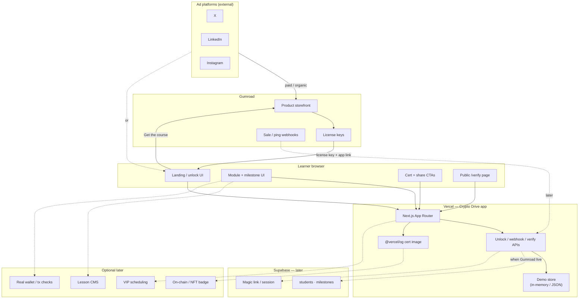
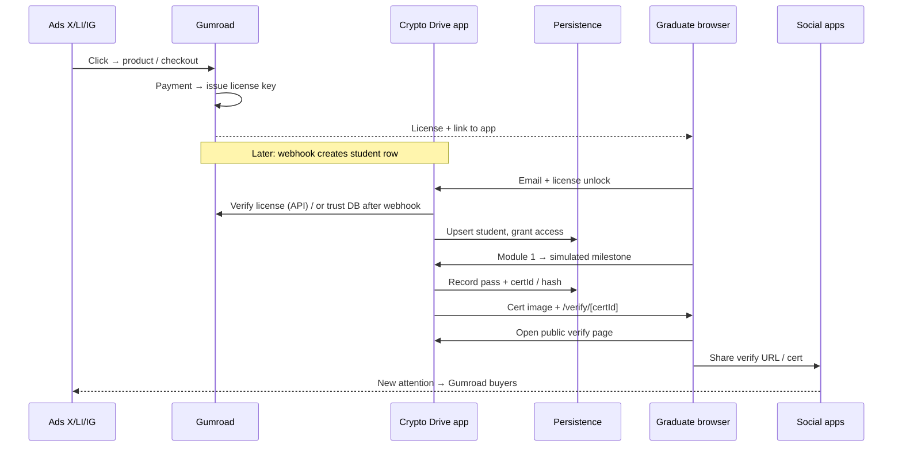

# Crypto Drive — Solution Architecture

Whole-system map for the licensed learner loop: ads → Gumroad → unlock → Module 1 milestone → cert → verify → share. Aligned with locked brand, Gumroad-only commerce, pro “learn to drive” positioning, **simulated milestones**, and **off-chain certs**.

---

## 1. System component diagram

Where each major piece lives.

---

## 2. Component inventory

| Component | Responsibility | Hosted / found where | Now (slice 1) vs Later |
| --- | --- | --- | --- |
| Ad creatives (X / LinkedIn / Instagram) | Drive traffic to Gumroad (or landing) | Ad platforms | **Later** — slogan + video deferred |
| Gumroad storefront | Checkout, product page, license issue | Gumroad | **Later** — placeholder URL in slice |
| Gumroad license keys | Unique buyer access credential | Gumroad | **Mock** now; live keys later |
| Gumroad webhooks / License API | Sync sale → student record; verify key | Gumroad → app | **Later** |
| Landing page | Pitch + “Get course” + “I have a license” | Vercel (Next.js) | **Now** |
| Unlock / access gate | Accept email + license; grant Module 1 | Vercel app | **Now** (mock key / env) |
| Module 1 + milestone UI | Coach cues + one simulated wallet checkpoint | Vercel app (in-app content) | **Now** |
| Modules 2–4 | Full curriculum | Vercel app | **Later** |
| Cert generator | Name, date, unique id/hash → PNG | Vercel (`@vercel/og` / satori) | **Now** |
| `/verify/[certId]` | Public attestation page | Vercel (public route) | **Now** |
| Share CTAs | Intent / copy links to X, LinkedIn, Instagram | Learner browser → social apps | **Now** |
| Demo persistence | Students, milestone pass, cert id | In-app memory / JSON | **Now**; Supabase later |
| Supabase DB + auth | Persist students/milestones; sessions | Supabase | **Later** (with live Gumroad) |
| Tier packaging (Starter / Certified / VIP) | SKU → access level | Gumroad products + app | **Later** (one path now) |
| VIP fulfillment | Scheduling / private channel | TBD tooling | **Later** |
| On-chain NFT / real tx milestones | Harder attestation / real funds practice | Chain / wallets | **Out of default**; optional later |

---

## 3. End-to-end request / data flow

Target path (live commerce). Slice 1 short-circuits steps 1–3 with a **mock license**.

**Slice 1 shortcut:** demo key (env/hardcoded) → unlock → milestone → cert → verify → share. No live Gumroad or Supabase.

---

## 4. Boundaries

### Not on Gumroad
- Interactive course, milestones, cert generation, verify pages  
- Student progress / attestation state  
- Full lesson body (Gumroad may host a thin welcome PDF only)

### Stays in-app (Vercel)
- Landing, unlock UI, Module shells, milestone challenges  
- Cert OG image + `/verify/[id]`  
- Share CTAs and coach-toned copy  

### Gumroad owns
- Product listing, payment, license key issuance  
- (Later) sale webhooks feeding the app  

### Mock in slice 1
- License unlock (no webhook / License API)  
- Persistence (local/demo, not Supabase)  
- Gumroad CTA URL (placeholder)  
- Single path (no tier SKUs)  

### Explicitly deferred / out of default
- Live ads, slogan, ad video  
- Real on-chain txs and NFT badges  
- Modules 2–4, VIP tooling  
- Banking keynote as product scope  

---

## 5. Locked defaults (architecture constraints)

| Decision | Implication |
| --- | --- |
| Brand: **Crypto Drive** | All surfaces use this name; drive/wallet coaching metaphor |
| **Gumroad only** | No Stripe storefront; commerce boundary = Gumroad |
| Pros + “learn to drive” | Copy/UI = coach, not classroom |
| Ads → Gumroad | Acquisition lands on Gumroad; app is post-purchase |
| **Simulated** milestones | No real funds / wallet-sign liability in v1 |
| **Off-chain** cert | Hash + public verify page; no NFT required |
| Content **in-app** | Gumroad = buy + license; course lives on Vercel |

---

## 6. Stack snapshot

| Layer | Choice |
| --- | --- |
| App | Next.js (App Router) + TypeScript + Tailwind |
| Host | Vercel |
| Commerce | Gumroad (license keys; webhooks later) |
| Data | Demo store now → Supabase later |
| Certs | `@vercel/og` / satori PNG + `/verify/[id]` |
| 3D journeys | Three.js via `@react-three/fiber` (v9, React 19 line) + `@react-three/drei` helpers, per-drive lazy chunks |

---

## 7. Immersive journey layer (2D-first; 3D parked)

**Status: the 2D illustration path is the production default.** The Glass
Observatory 3D stack below stays in-tree but unmounted and unfetched behind
the master switch `JOURNEY_3D_ENABLED=false`
(`src/components/journey/enabled.ts`; gated in `drive-step.tsx` and the drive
`layout.tsx`). Procedural low-poly 3D could not reach the senior,
realistic bar, so the CSS toy scenes in `src/components/drive-toys.tsx` are
the current experience — not the fallback.

**2D layout contract (enforced by `layout.mjs` in the Playwright harness):**
the left illustration card never exceeds the drive-head width
(`leftCard.right ≤ head.right`) at 1440×900 and 390×844, in both themes.
The `.drive-split` grid is symmetric at ≥900px (equal 1fr/1fr stretch columns;
the illustration card fills the row height) and stacks below that.
Each step head shows its drive's `outcome` line; Back/Continue are floating
pills with no container chrome.

**Keyboard drive:** ArrowLeft clicks Back, ArrowRight clicks the footer primary,
ArrowUp/Down rove focus through `main` — all skipped while typing in a field
(`drive-step.tsx` keydown effect; clicks live DOM so rapid presses never hit a
stale closure).

**CSS pitfall (learned the hard way):** `%` inside `calc()` is a percentage,
never a modulo operator — `calc(var(--i) % 3)` is invalid CSS and the whole
declaration is dropped (all 9 satoshi nodes and all 18 barrel coins silently
stacked at one point). Precompute grid coordinates in TSX (`--col`/`--row`)
and keep `calc()` to plain multiply/add.

Each drive was designed as one continuous 3D world with steps as camera stops
along a road. Storyboards and art direction: `docs/journey-storyboards.md`.

| Piece | File(s) | Notes |
| --- | --- | --- |
| Persistent stage | `src/app/track/[slug]/[drive]/layout.tsx` + `src/components/journey/JourneyStageLazy.tsx` + `JourneyStage.tsx` | Layout-level Canvas survives step navigation, so the camera flies instead of flashing. The whole 3D stack loads via `next/dynamic` `ssr: false` after first paint — content and HUD never wait for it. |
| Camera + lights + labels | `src/components/journey/rig.tsx` (three/fiber only), `rig-drei.tsx` (drei: labels, sparkles, valley shell) | Split keeps drei out of the route chunk. No shadow maps (blob shadows), DPR capped at 1.75, instancing for repeated geometry. FOV 38; wide-screen look-shift +1.4 X in `CameraDirector`. |
| Glass kit | `src/components/journey/rig-glass.tsx` | `VitrineShell` (active stop only), `DriveArch`, `GlassPlinth`. Fixed roof cap — win is an amber glow + dissolving front glass, never moving geometry (moving lids intrude into frame). |
| Theme | `src/components/journey/palette.ts` + `use-theme-mode.ts` | Static light/dark palettes; the 3D layer subscribes to the page theme live via `MutationObserver` on `<html class>`. Worlds re-render instantly on toggle. |
| Registry | `src/components/journey/registry.ts` | Three-free: journey-enabled drives + camera anchors per step. Safe to import from 2D UI. |
| Signal bus | `src/components/journey/journey-bus.ts` | Tiny `useSyncExternalStore` bus. 2D scenes publish progress (`cheques-progress`, `fee-pace`, …); worlds subscribe. Reset on every step change. |
| Worlds | `src/components/journey/worlds/bitcoin-*.tsx` (+ `what-is/*.tsx` vignettes) | One module per drive, dynamically imported. Vignettes read `step:win` + signals for payoffs. |
| HUD mode | `src/components/drive-step.tsx` (`BareContext` + `drive-immersive` grid) | On WebGL-capable drives the step renders as HUD panels over the world; otherwise the legacy Split + CSS toy layout renders unchanged. |

**Fallback contract (locked):**

- No WebGL (`useWebGLAvailable`) or 3D runtime error (`StageBoundary`) → legacy Split + CSS toys in `src/components/drive-toys.tsx`. Those toys are the permanent fallback layer — do not delete them.
- `prefers-reduced-motion` → camera jump-cuts, vignettes render end-state poses, sparkles hidden. Zero continuous motion.
- SSR / first paint → no 3D code on the initial route bundle; verified by keeping `three`/`@react-three/drei` out of statically imported modules.

**Engine choice:** Three.js + React Three Fiber over Babylon.js — our scenes are
cinematic dioramas (camera choreography + state-driven vignettes), not a
simulated world, so a renderer beats a full game engine (physics/audio/nav) on
weight and React fit. Revisit only if a future drive needs real physics.

**Perf budgets (enforced by the theme-matrix probe via `window.__journeyPerf`):**
render calls < 450, triangles < 400000, textures < 90, geometries < 200 per
stop. Typical stop: ~50–100 calls, ~40k triangles. One transmission surface
max (traveler orb); no postprocessing; no shadow maps.

**Validation notes (Playwright, committed scripts):**

- Full walk + reduced-motion + mobile + no-WebGL on the 2D path: all green,
  0 failures. The harness asserts the 2D illustration card mounts and no
  `.journey-stage` exists; element-level tease/win captures cover all 7
  what-is toys in both themes.
- Recall-loop harness lesson: after the final recall tap the app keeps
  showing `WORD 9` (by design) while the Continue link appears — so the loop
  must wait for *either* a new title *or* Continue, never a title change
  alone. A lonely title-watch is a race that fails ~40% of runs under load.
- Framing is judged on settled screenshots (≥2.8s after arrival); earlier
  shots catch the camera mid-flight.
